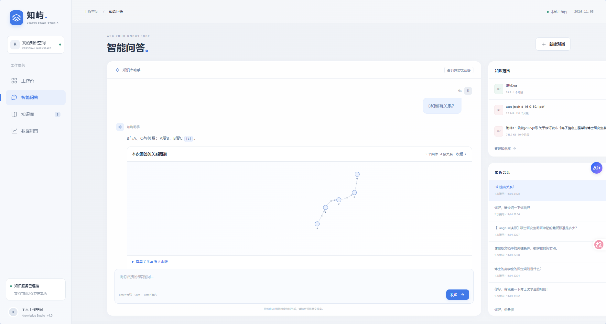

# 知屿 · Knowledge Studio

**面向个人资料的 RAG 知识工作台：让回答有出处，让原文可核对。**

[简体中文完整说明](Readme/README.md) · [English](Readme/README.en.md)

  <a href="Readme/README.md#highlights">项目亮点</a> ·
  <a href="Readme/README.md#demo">实际界面</a> ·
  <a href="Readme/README.md#architecture">架构设计</a> ·
  <a href="Readme/README.md#quick-start">快速开始</a> ·
  <a href="Readme/README.md#validation">验证与边界</a> ·
  <a href="Readme/README.md#documentation">文档</a> ·
  <a href="Readme/README.md#license">许可与来源</a>

> 截图使用隔离数据库、合成资料和预置演示回答，用于展示交互，不作为模型效果评测。

完整中英文项目说明统一放在 `Readme/`，包含架构、安装配置、演示、验证方法及许可信息。
