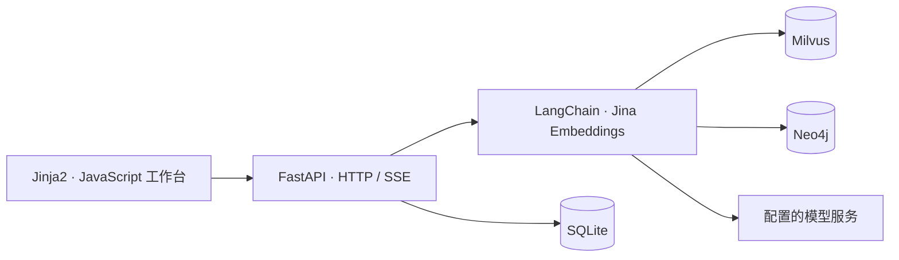

# 知屿 · Knowledge Studio

**把个人文档变成可追问、可查证的知识库。** 知屿将文档管理、Milvus 向量检索、Neo4j 关系检索和带引用的流式问答放在同一个本地工作台中。

[技术框架](#architecture) · [界面与演示](#demo) · [部署说明](#deployment) · [完整中文说明](Readme/README.md) · [English](Readme/README.en.md)


*项目运行截图：智能问答、回答引用、关系图谱、知识范围与最近会话。当前应用界面为中文。*

## 可以做什么

| 使用场景 | 对应能力 |
| --- | --- |
| 整理 PDF、Word 和笔记 | 支持 PDF、DOCX、TXT、Markdown，后台建库并显示处理阶段 |
| 查找文档中的答案 | 向量与图谱双路检索，融合证据后流式生成回答 |
| 连续追问同一个主题 | 根据近期对话改写检索问题，处理“它”“这个方案”等指代 |
| 核对回答是否有依据 | 点击引用查看完整原文、定位片段，展开本次检索的关系图谱 |
| 维护本地资料 | 文档单选或批量删除、会话持久化、资料命中与耗时统计 |

<a id="demo"></a>
## 界面与使用演示

| 页面 | 地址 | 主要操作 |
| --- | --- | --- |
| 工作台 | `/` | 查看资料统计、问答活动和最近收录，进入问答或知识库 |
| 智能问答 | `/chat` | 新建或恢复会话、连续追问、点击引用、展开或折叠关系图谱 |
| 知识库 | `/knowledge` | 上传和筛选文档、查看建库任务、单份或批量删除 |
| 数据洞察 | `/insights` | 按近 7 天或 30 天查看问答趋势、命中与耗时统计 |

一次完整演示：**上传文档 → 等待建库 → 提问与追问 → 点击引用核对原文 → 展开关系图谱**。例如上传“林然负责天枢项目，天枢项目使用青岚数据库”，先问项目负责人，再追问“它使用什么数据库？”。启用图谱并抽取到有效关系后，可检查实体之间的连接。完整步骤见[短文档试用](Readme/README.md#demo)。

<a id="deployment"></a>
## 部署与快速开始

以下命令面向 **Windows PowerShell + Python 3.10**。开始前需要可连接的 **Milvus** 和模型服务；启用 Neo4j 图谱时还需要 Docker Desktop。

部署结构：**Python 应用 + Milvus + 可选 Neo4j + 配置的模型服务**。本仓库的 `compose.neo4j.yml` 只部署 Neo4j；应用运行在 Python 进程中，Milvus 需要提前准备。

### 1. 安装依赖

```powershell
git clone https://github.com/Auroral666/KB_project.git
cd KB_project
py -3.10 -m venv .venv
.\.venv\Scripts\python.exe -m pip install -r requirements.txt
Copy-Item .env.example .env
```

### 2. 编辑 `.env`

配置模型服务的 `openai_api_key`、`openai_base_url`、`openai_llm_model_name`，确认 `milvus_host`、`milvus_port` 和 `text_embeddings_model_path`。

- 使用完整混合检索：保留 `neo4j_enabled=true`，设置自己的 `neo4j_password`。
- 先体验向量问答：设置 `neo4j_enabled=false`，可跳过 Neo4j。
- Milvus 启动器仅复用已有服务或容器，首次安装与全部配置见[完整启动步骤](Readme/README.md#quick-start)。

### 3. 启动并使用

```powershell
$env:RAG_PYTHON = (Resolve-Path .\.venv\Scripts\python.exe).Path
.\启动_停止项目\启动项目.cmd
```

打开 [http://127.0.0.1:8010](http://127.0.0.1:8010)，进入“知识库”上传文档，等待任务成功，再进入“智能问答”提问。回答中的引用可打开完整原文；有关系证据时可展开图谱。

停止网页服务：

```powershell
.\启动_停止项目\停止项目.cmd
```

停止网页不会停止数据库容器。首次使用可能下载嵌入模型；`RAG_PYTHON` 需在新终端重新设置。更多说明见[配置与启动](Readme/README.md#quick-start)和[常见问题](Readme/README.md#troubleshooting)。

<a id="architecture"></a>
## 技术框架与处理流程



| 层次 | 技术 |
| --- | --- |
| 服务与模型 | FastAPI、LangChain、Sentence Transformers、Jina Embeddings v3、OpenAI 兼容模型接口 |
| 数据存储 | SQLite 保存业务记录，Milvus 保存向量，Neo4j 保存实体关系 |
| 浏览器工作台 | Jinja2、原生 JavaScript/CSS、SSE、PDF.js、Vis Network、Marked、DOMPurify |

**建库链路**：原文件保存 → 语义分块 → 嵌入与关系抽取 → 写入索引 → 发布文档清单。

**问答链路**：近期对话改写 → 并行向量/图谱检索 → 按文档片段融合 → 流式回答与引用 → 完整结果落库。具体流程与取舍见[架构设计](Readme/README.md#architecture)及[混合检索说明](docs/hybrid-rag.md)。

## 文档与验证

- [中文使用说明](Readme/README.md)：配置、使用示例、设计取舍与常见问题。
- [English guide](Readme/README.en.md)：英文完整说明。
- [架构与数据维护](docs/architecture.md)：模块职责、数据位置与维护约定。
- [回归测试](tests/README.md)：隔离 Python 测试及前端 DOM 检查。
- [固定样例评估记录](docs/sprint-validation.md)：小样本对照方法与结果。

本项目面向本机个人使用，采用单进程建库队列。单文件上限 20 MB；扫描 PDF 需先 OCR。原文件与会话保存在本地，问题改写、关系抽取和回答生成会向配置的模型服务发送相关内容。完整边界见[验证与限制](Readme/README.md#validation)。
