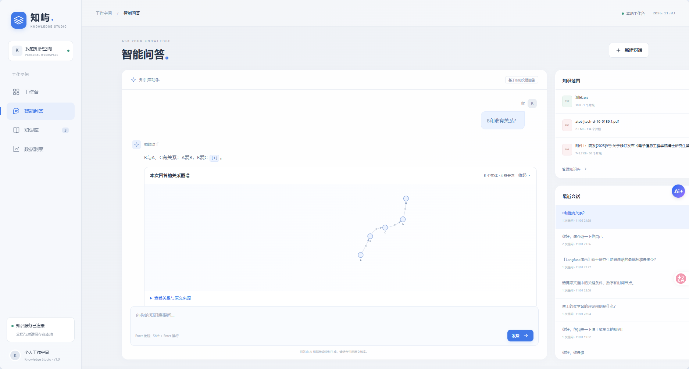
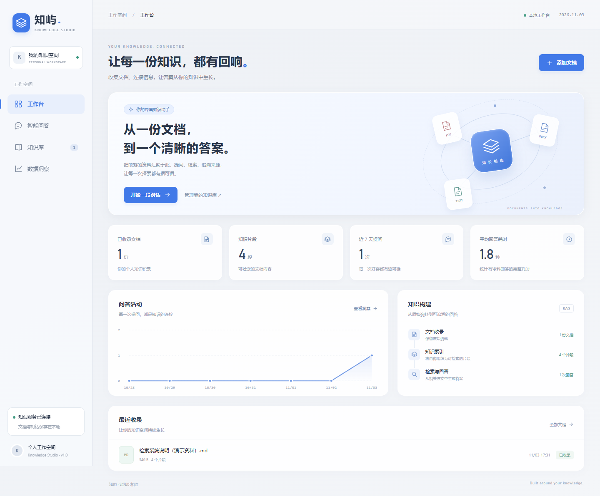
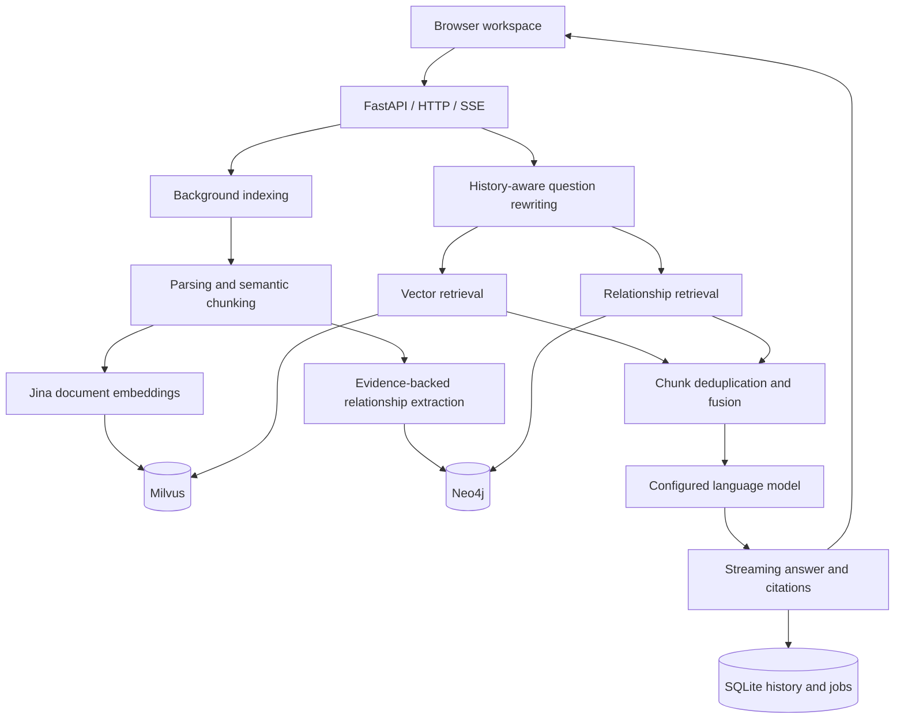

# Knowledge Studio · 知屿

**A personal RAG workspace with hybrid retrieval, source citations, and full-document verification.**

[简体中文](README.md) · [English](README.en.md)

<p align="center">
  <a href="#highlights">Highlights</a> ·
  <a href="#demo">Screenshots</a> ·
  <a href="#architecture">Architecture</a> ·
  <a href="#quick-start">Quick start</a> ·
  <a href="#validation">Validation & limits</a> ·
  <a href="#documentation">Documentation</a> ·
  <a href="#license">License & credits</a>
</p>



> Screenshots show the actual UI with an isolated database, synthetic documents, and a predefined demonstration answer. They demonstrate the interface, not model quality. Both Chinese and English READMEs are available; the application UI is currently Chinese.

<a id="highlights"></a>
## Highlights

When knowledge lives across PDFs, Word documents, and notes, a plausible answer alone is difficult to trust. This project connects document management, retrieval, generation, citations, and original-document reading in one workspace.

| Capability | Implementation | Visible result |
| --- | --- | --- |
| Hybrid retrieval | Milvus vector search and Neo4j entity relationships, fused by document chunk | Semantic matches plus relationship evidence |
| Verifiable answers | Document IDs, chunks, pages, and links to complete originals | Open a citation and inspect its source |
| Background indexing | SQLite job state, one worker, compensation, restart recovery | Immediate job ID and processing stages |
| Follow-up questions | Rewrite a question using recent answered turns | Resolve references before retrieval |
| Streaming interaction | SSE status, sources, graph data, and text deltas | Incremental answers with completed results persisted |
| Local operations | Process ownership checks, health probes, and duplicate-start detection | Managed startup and shutdown |

The extensions in this version cover the workspace UI, document lifecycle, hybrid retrieval, source reading, persistence, and local operations. Adapted upstream embedding components retain their attribution in [NOTICE](../docs/third-party/NOTICE).

<a id="demo"></a>
## Screenshots and walkthrough



1. Upload a PDF, DOCX, TXT, or Markdown document and wait for indexing.
2. Ask a question and inspect the streamed answer; continue with a follow-up.
3. Open a citation to inspect the full original, or expand the retrieved relationship graph.
4. Check retrieval hits, answer duration, and history in the insights view.

See the [architecture guide](../docs/architecture.md) for implementation details.

<a id="architecture"></a>
## Architecture



- **Milvus** stores vectors and chunks, **Neo4j** stores relationships, and **SQLite** stores application records.
- The Python backend loads **Jina embeddings**. The UI's vector-service indicator checks the **Milvus connection**.
- A document enters the inventory after both indexes are written. Compensation handles partial failure; this is not a distributed transaction.
- OpenAI-compatible configuration controls model endpoints and names. See the [hybrid retrieval guide](../docs/hybrid-rag.md) for details.

| Layer | Technologies |
| --- | --- |
| Backend | Python, FastAPI, Uvicorn, Pydantic |
| Retrieval and models | LangChain adapters, Sentence Transformers, Jina Embeddings v3 |
| Storage | SQLite, Milvus, Neo4j |
| Frontend | Jinja2, JavaScript/CSS, SSE |
| Source and graph views | PDF.js, Vis Network |
| Markdown rendering | Marked and DOMPurify |
| Optional tracing | Separate Langfuse launcher |

## Repository layout

```text
KB_project/
├── app/
│   ├── api/                 Pages, documents, and chat endpoints
│   ├── services/            Indexing, retrieval, extraction, generation
│   ├── repositories/        SQLite access
│   ├── web/                 Templates, assets, and component licenses
│   ├── config.py            Root-relative configuration
│   ├── cli.py               Web process lifecycle
│   └── milvus_cli.py        Existing-container startup and readiness
├── 启动_停止项目/           Windows CMD / PowerShell launchers
├── langfuse/                Optional tracing integration
├── tests/                   Isolated regression tests and evaluation fixtures
├── docs/                    Architecture, demos, and publication scope
├── data/                    Local SQLite; only a placeholder is published
└── upload_files/            Private uploaded originals; excluded from Git
```

<a id="quick-start"></a>
## Quick start

### 1. Prepare the environment

Use Python 3.10 and a reachable Milvus instance. Graph-enabled operation also needs Docker Desktop; [compose.neo4j.yml](../compose.neo4j.yml) manages Neo4j.

```powershell
git clone https://github.com/Auroral666/KB_project.git
cd KB_project
py -3.10 -m venv .venv
.\.venv\Scripts\python.exe -m pip install -r requirements.txt
Copy-Item .env.example .env
```

Edit `.env` and check:

| Setting | Purpose |
| --- | --- |
| `openai_api_key`, `openai_base_url`, `openai_llm_model_name` | Generation, question rewriting, and relationship extraction |
| `text_embeddings_model_path` | Jina model identifier or a prepared local directory |
| `milvus_host`, `milvus_port` | Existing Milvus endpoint; defaults to `localhost:19530` |
| `neo4j_password` | Your own local Neo4j password |
| `neo4j_enabled` | Set to `false` for vector-only retrieval |

A model identifier may download weights and model code on first use. Offline embeddings require a complete local model cache. Model licenses and provider terms apply separately.

### 2. Prepare Milvus

For a new installation, follow the [official Milvus deployment instructions](https://milvus.io/docs/v2.6.x/install_standalone-docker-compose.md). This launcher **resumes existing containers; it does not install or recreate Milvus**.

The default local names are `milvus-etcd`, `milvus-minio`, and `milvus-standalone`. Override them with `milvus_etcd_container`, `milvus_minio_container`, and `milvus_container`. A remote Milvus instance is checked, not started locally.

### 3. Start the workspace

```powershell
$env:RAG_PYTHON = (Resolve-Path .\.venv\Scripts\python.exe).Path
.\启动_停止项目\启动项目.cmd
```

Open **http://127.0.0.1:8010**. Startup checks Milvus, Neo4j, and the web server in order. Embedding warmup continues in the background.

```powershell
.\启动_停止项目\停止项目.cmd
# Alternatively, run a foreground instance; Ctrl+C stops that instance:
.\.venv\Scripts\python.exe -B -X utf8 -m app
```

The stop launcher leaves database containers running. Closing the startup window does not stop the background server. Set `RAG_PYTHON` in each new terminal or as a user environment variable; the original Conda path is only a compatibility default.

Health: `GET /health`. Retrieval/model/graph state: `GET /api/status`. Logs: `temp/runtime/`.

<a id="validation"></a>
## Validation and limits

Run the isolated regression suite without external generation-model calls:

```powershell
.\.venv\Scripts\python.exe -m pip install -r tests/requirements.txt
.\.venv\Scripts\python.exe -B -X utf8 -m unittest discover -s tests -p "test_*.py" -v
```

See [tests/README.md](../tests/README.md) for DOM checks and opt-in live evaluation. Live evaluation uses configured model services and may incur charges.

- Indexing uses a single-process worker queue; do not share it across multiple Uvicorn workers.
- PDF, DOCX, TXT, and MD uploads are limited to 20 MB per file. Scans require OCR first; DOCX uses extracted text rather than Word layout.
- Source-hit rate is not answer accuracy. Fixed-fixture evaluation does not establish production quality.
- Original files and application records stay local, but rewriting, extraction, and generation send relevant history or document fragments to the configured model service.
- This is a local personal workspace; publishing source does not make it a production multi-tenant service.

<a id="documentation"></a>
## Documentation

- [Architecture and data maintenance](../docs/architecture.md)
- [Hybrid retrieval and graph setup](../docs/hybrid-rag.md)
- [Graph contract](../docs/graph-contract.md)
- [Publication scope](../docs/PUBLISHING.md)
- [Chinese README](README.md)

<a id="license"></a>
## License and credits

Adapted components from Knowledge_QA_RAG by CS_木成河 retain the upstream Apache License 2.0 and attribution. See [LICENSE](../docs/third-party/LICENSE) and [NOTICE](../docs/third-party/NOTICE). Frontend component licenses remain under `app/web/static/vendor/`; model weights and model services have their own terms.
