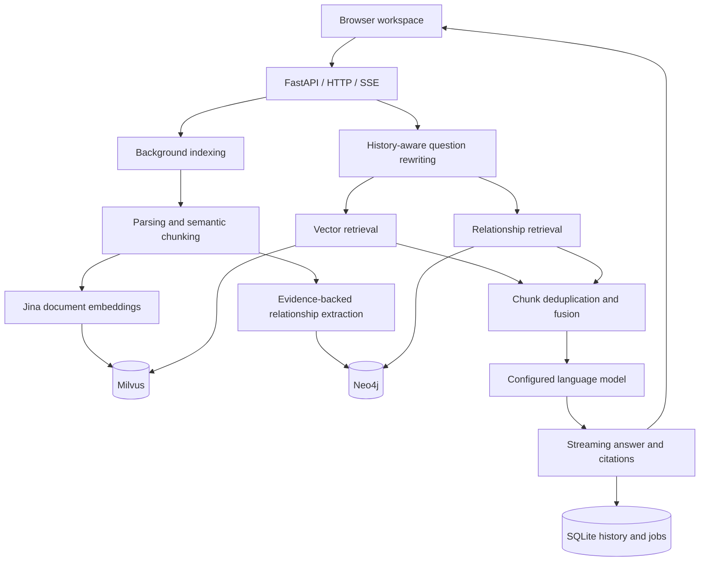

# Knowledge Studio · 知屿

**Turn personal documents into a knowledge base you can question and verify.**

Knowledge Studio is a local RAG workspace that retrieves evidence through vectors and entity relationships, then streams answers with citations. Use it to organize project documents, study notes, and text-based PDFs while checking answers against the original files.

[Project home](../README.md) · [简体中文](README.md) · [English](README.en.md)

<p align="center">
  <a href="#highlights">Highlights</a> ·
  <a href="#demo">Screenshots</a> ·
  <a href="#architecture">Architecture</a> ·
  <a href="#deployment">Deployment</a> ·
  <a href="#quick-start">Quick start</a> ·
  <a href="#troubleshooting">Troubleshooting</a> ·
  <a href="#validation">Validation & limits</a> ·
  <a href="#documentation">Documentation</a>
</p>


> Application screenshot: the chat page with answer citations, a relationship graph, the knowledge scope, and recent conversations. Both Chinese and English READMEs are available; the application UI is currently Chinese.

<a id="highlights"></a>
## Highlights

When knowledge lives across PDFs, Word documents, and notes, a plausible answer alone is difficult to trust. This project connects document management, retrieval, generation, citations, and original-document reading in one workspace.

| Capability | Implementation | Visible result |
| --- | --- | --- |
| Hybrid retrieval | Milvus vector search and Neo4j entity relationships, fused by document chunk | Semantic matches plus relationship evidence |
| Verifiable answers | Document IDs, chunks, pages, and links to complete originals | Open a citation and inspect its source |
| Background indexing | SQLite job state, one worker, compensation, restart recovery | Immediate job ID and processing stages |
| Follow-up questions | Rewrite a question using recent answered turns | Resolve references before retrieval |
| Streaming interaction | SSE status, sources, graph data, and text deltas | Incremental answers with completed results persisted |
| Local operations | Process ownership checks, health probes, and duplicate-start detection | Managed startup and shutdown |

<a id="demo"></a>
## Screenshots and walkthrough

| Page | Route | Interface and interactions |
| --- | --- | --- |
| Workspace | `/` | Document and question statistics, activity trends, recent uploads, and shortcuts |
| Chat | `/chat` | Streaming answers, citations and original-text navigation, expandable relationship graphs, knowledge scope, and conversation history |
| Knowledge base | `/knowledge` | Uploads, background-task progress, filename and type filters, and individual or batch deletion |
| Insights | `/insights` | 7-day or 30-day question trends, source hits, timings, and history |

### Walkthrough

1. Upload a PDF, DOCX, TXT, or Markdown document and wait for indexing.
2. Ask a question and inspect the streamed answer; continue with a follow-up.
3. Open a citation to inspect the full original, or expand the retrieved relationship graph.
4. Check retrieval hits, answer duration, and history in the insights view.

### Try a short document

Create a TXT file with these two sentences, upload it, and wait for indexing:

```text
Lin Ran leads the Tian Shu project.
The Tian Shu project uses the Qing Lan database.
```

In the same conversation, ask “Who leads the Tian Shu project?”, followed by “Which database does it use?”. Check the citations against the uploaded file and open the original text. If graph extraction is enabled and finds valid relationships, inspect the connected nodes as well. This example illustrates the workflow; actual answers depend on the model and retrieval results.

See the [architecture guide](../docs/architecture.md) for implementation details.

<a id="architecture"></a>
## Architecture



- **Milvus** stores vectors and chunks, **Neo4j** stores relationships, and **SQLite** stores application records.
- The Python backend loads **Jina embeddings**. The UI's vector-service indicator checks the **Milvus connection**.
- A document enters the inventory after both indexes are written. Compensation handles partial failure; this is not a distributed transaction.
- OpenAI-compatible configuration controls model endpoints and names. See the [hybrid retrieval guide](../docs/hybrid-rag.md) for details.

| Layer | Technologies |
| --- | --- |
| Backend | Python, FastAPI, Uvicorn, Pydantic |
| Retrieval and models | LangChain adapters, Sentence Transformers, Jina Embeddings v3 |
| Storage | SQLite, Milvus, Neo4j |
| Frontend | Jinja2, JavaScript/CSS, SSE |
| Source and graph views | PDF.js, Vis Network |
| Markdown rendering | Marked and DOMPurify |
| Optional tracing | Separate Langfuse launcher |

### Frameworks and code entry points

| Module | Framework or responsibility | Entry points |
| --- | --- | --- |
| Web application | FastAPI routing, lifecycle, HTTP, and SSE | [Application assembly](../app/main.py), [chat API](../app/api/chat.py) |
| Indexing | Parsing, semantic chunking, durable tasks, and recovery | [Task scheduling](../app/services/index_jobs.py), [document processing](../app/services/documents.py) |
| Retrieval and generation | LangChain adapters, Jina embeddings, parallel retrieval, evidence fusion, and model generation | [RAG service](../app/services/rag.py), [knowledge graph](../app/services/knowledge_graph.py) |
| Data and interface | SQLite records, Jinja2 templates, and JavaScript interactions | [Business storage](../app/repositories/workspace.py), [UI template](../app/web/templates/workspace.html) |

### Design decisions

- **Persist tasks before processing them**: uploads do not wait for the entire indexing pipeline. Progress survives restarts, and unfinished tasks are recovered.
- **Separate stores with compensating cleanup**: SQLite, Milvus, and Neo4j own business records, vectors, and relationships. Failed writes trigger cleanup attempts; the document inventory is published after both indexes are ready.
- **Save complete answers**: SSE displays text incrementally, while interrupted generations are kept out of completed conversation history.
- **Connect graph views and citations to evidence**: graphs show relationships in the retrieved context, and source reading opens the complete document rather than only the retrieved excerpt.

## Repository layout

```text
KB_project/
├── app/
│   ├── api/                 Pages, documents, and chat endpoints
│   ├── services/            Indexing, retrieval, extraction, generation
│   ├── repositories/        SQLite access
│   ├── web/                 Templates, assets, and component licenses
│   ├── config.py            Root-relative configuration
│   ├── cli.py               Web process lifecycle
│   └── milvus_cli.py        Existing-container startup and readiness
├── 启动_停止项目/           Windows CMD / PowerShell launchers
├── langfuse/                Optional tracing integration
├── tests/                   Isolated regression tests and evaluation fixtures
├── docs/                    Architecture, demos, and publication scope
├── data/                    Local SQLite; only a placeholder is published
└── upload_files/            Private uploaded originals; excluded from Git
```

<a id="deployment"></a>
## Deployment

| Component | Runtime | Default endpoint or location |
| --- | --- | --- |
| Web and API | Python / Uvicorn process managed by Windows launchers | `http://127.0.0.1:8010` |
| Milvus | Existing local containers or a remote service | `localhost:19530`, configurable in `.env` |
| Neo4j (optional) | Project `compose.neo4j.yml`, pinned to `neo4j:5.26.0-community` | Browser: `127.0.0.1:7474`; Bolt: `127.0.0.1:7687` |
| Embeddings | Loaded inside the Python process on CUDA or CPU | Model identifier or local directory in `.env` |
| Generation model | Configured OpenAI-compatible service | Endpoint and model name in `.env` |
| Business records | Local SQLite database and original files | `data/workspace.db`, `upload_files/` |

- **Full workflow**: prepare Milvus, configure the model service and Neo4j password, then use the launcher to check databases and start the web server.
- **Simplified workflow**: set `neo4j_enabled=false` to skip Neo4j while keeping document management, vector retrieval, and cited answers.
- **Databases already running**: use the foreground Python command below to start only the web server; it does not start databases.

The repository supplies a Compose file for Neo4j, not a Dockerfile or a one-command container deployment for the entire stack. The service is designed for local access; public or multi-user operation requires additional authentication, access isolation, and reverse-proxy design.

<a id="quick-start"></a>
## Quick start

### 1. Prepare the environment

The commands below use **Windows PowerShell and Python 3.10**. Prepare:

| Requirement | Details |
| --- | --- |
| Python 3.10 | Use a virtual environment; dependencies are pinned in `requirements.txt` |
| Milvus | A reachable local or remote instance; the Python client is pinned to `pymilvus==2.4.8` |
| Model service | An OpenAI-compatible endpoint, model name, and working API key |
| Embedding model | The default `jinaai/jina-embeddings-v3`, or a complete local model directory |
| Docker Desktop | Needed when the launchers manage local database containers; the project Compose file manages Neo4j |

Set `neo4j_enabled=false` in `.env` to start with vector-only answers. Keep it `true` for full hybrid retrieval.

```powershell
git clone https://github.com/Auroral666/KB_project.git
cd KB_project
py -3.10 -m venv .venv
.\.venv\Scripts\python.exe -m pip install -r requirements.txt
Copy-Item .env.example .env
```

Edit `.env` and check:

| Setting | Purpose |
| --- | --- |
| `openai_api_key`, `openai_base_url`, `openai_llm_model_name` | Generation, question rewriting, and relationship extraction |
| `text_embeddings_model_path` | Jina model identifier or a prepared local directory |
| `milvus_host`, `milvus_port` | Existing Milvus endpoint; defaults to `localhost:19530` |
| `neo4j_password` | Your own local Neo4j password |
| `neo4j_enabled` | Set to `false` for vector-only retrieval |
| `history_turns`, `semantic_threshold` | Defaults: 4 conversation turns and a 0.55 adjacent-sentence similarity threshold |

Using a model identifier may download weights and model code on first use. Offline embeddings require a complete local cache. The code selects CUDA or CPU based on availability. Replace the example model settings and key placeholders with values supported by your provider.

### 2. Prepare Milvus

For an initial deployment, consult the [official Milvus 2.4 Compose guide](https://milvus.io/docs/v2.4.x/install_standalone-docker-compose.md) and select the configuration for your server version. This repository does not include a Milvus Compose file. The launcher **resumes existing containers; it does not install or recreate Milvus**.

The default local names are `milvus-etcd`, `milvus-minio`, and `milvus-standalone`. Override them with `milvus_etcd_container`, `milvus_minio_container`, and `milvus_container`. A remote Milvus instance is checked, not started locally.

### 3. Start the workspace

```powershell
$env:RAG_PYTHON = (Resolve-Path .\.venv\Scripts\python.exe).Path
.\启动_停止项目\启动项目.cmd
```

Open [http://127.0.0.1:8010](http://127.0.0.1:8010). Startup checks Milvus, Neo4j, and the web server in order, skipping Neo4j when disabled. Background warmup runs when enabled and documents already exist; the first upload or retrieval may still wait for model loading.

```powershell
.\启动_停止项目\停止项目.cmd
# Alternatively, run a foreground instance; Ctrl+C stops that instance:
.\.venv\Scripts\python.exe -B -X utf8 -m app
```

The stop launcher leaves database containers running. Closing the startup window does not stop the background server. Set `RAG_PYTHON` in each new terminal or as a user environment variable; the original Conda path is only a compatibility default.

### 4. Check readiness

```powershell
Invoke-RestMethod http://127.0.0.1:8010/health
Invoke-RestMethod http://127.0.0.1:8010/api/status
```

`/health` reports application liveness. In `/api/status`, `database` indicates Milvus connectivity, `embedding_loaded` indicates whether the embedding model is loaded, and `graph` reports graph configuration and connectivity. Logs are in `temp/runtime/`.

<a id="troubleshooting"></a>
## Troubleshooting

| Symptom | What to check |
| --- | --- |
| Python is not found | Set `RAG_PYTHON` in the current PowerShell session to the project's virtual-environment executable; the compatibility default may refer to a different machine |
| Milvus is not ready | Check the endpoint and container names in `.env`; containers must already be installed, and remote services must be started on their host |
| Model requests fail | Check the key, endpoint, model name, and provider response; replace placeholders in `.env` and restart the web service after configuration changes |
| First indexing is slow | Check model downloads and the local cache; CPU embeddings, semantic chunking, and relationship extraction take time. Inspect task stages and logs |
| Citations appear but the graph is empty | Check that graph retrieval is enabled, Neo4j is reachable, and the document contains relationships that pass literal-evidence checks. Documents without valid relationships can still be indexed as vectors |
| A PDF has no extractable text | Run OCR first for scanned files; the parser does not perform OCR |

### Local data locations

| Location | Contents |
| --- | --- |
| `data/workspace.db` | Document inventory, indexing tasks, conversations, and messages |
| `upload_files/` | Uploaded originals |
| Milvus collection / Neo4j namespace | Both default to `kb_project_knowledge`; configurable in `.env` |
| `temp/runtime/` | Service logs and process records |

Backups should account for business records, originals, and both indexes; see [data maintenance](../docs/architecture.md). Private environment files, actual data, and local temporary files are excluded by Git ignore rules.

<a id="validation"></a>
## Validation and limits

Run the isolated regression suite without external generation-model calls:

```powershell
.\.venv\Scripts\python.exe -m pip install -r tests/requirements.txt
.\.venv\Scripts\python.exe -B -X utf8 -m unittest discover -s tests -p "test_*.py" -v
```

See [tests/README.md](../tests/README.md) for DOM checks and opt-in live evaluation. Live evaluation uses configured model services and may incur charges.

- Indexing uses a single-process worker queue; do not share it across multiple Uvicorn workers. Task cancellation and automatic retry of failed tasks are not implemented; resolve the cause and upload again.
- PDF, DOCX, TXT, and MD uploads are limited to 20 MB per file. Scans require OCR first; DOCX uses extracted text rather than Word layout.
- Source-hit rate is not answer accuracy. Fixed-fixture evaluation does not establish production quality.
- Original files and application records stay local, but rewriting, extraction, and generation send relevant history or document fragments to the configured model service.
- This is a local personal workspace; publishing source does not make it a production multi-tenant service.

<a id="documentation"></a>
## Documentation

- [Architecture and data maintenance](../docs/architecture.md)
- [Hybrid retrieval and graph setup](../docs/hybrid-rag.md)
- [Graph contract](../docs/graph-contract.md)
- [Publication scope](../docs/PUBLISHING.md)
- [Fixed-fixture evaluation record](../docs/sprint-validation.md)
- [Optional Langfuse tracing](../langfuse/Langfuse观测说明.txt)
- [Chinese README](README.md)
