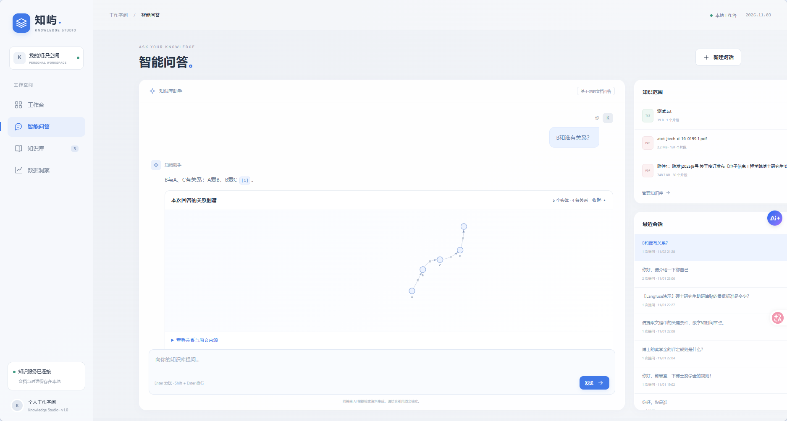
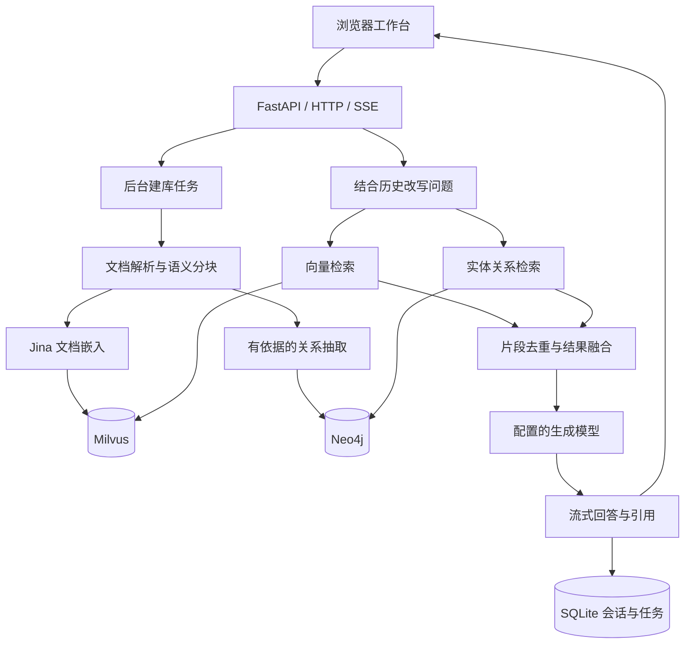

# 知屿 · Knowledge Studio

**把个人文档变成可追问、可查证的知识库。**

知屿是面向本机个人使用的 RAG 工作台：上传资料后，通过向量与关系图谱检索获取证据，再生成带引用的回答。适合整理项目文档、学习笔记和可提取文字的 PDF，并在阅读原文时核对答案。

[项目首页](../README.md) · [简体中文](README.md) · [English](README.en.md)

<p align="center">
  <a href="#highlights">项目亮点</a> ·
  <a href="#demo">实际界面</a> ·
  <a href="#architecture">架构设计</a> ·
  <a href="#quick-start">快速开始</a> ·
  <a href="#troubleshooting">常见问题</a> ·
  <a href="#validation">验证与边界</a> ·
  <a href="#documentation">文档</a>
</p>



> 项目运行截图：智能问答页面，展示回答引用、关系图谱、知识范围与最近会话。README 提供中英文版本，当前应用界面为中文。

<a id="highlights"></a>
## 项目亮点

资料分散在 PDF、Word 和笔记里时，单纯生成一段答案很难让人判断是否可信。本项目将文档管理、检索、回答、引用和原文阅读放在同一个工作台中。

| 能力 | 代码中的实现 | 用户能看到什么 |
| --- | --- | --- |
| 双路检索 | Milvus 向量召回 + Neo4j 实体关系查询，按片段融合 | 语义相关资料和跨文档关系证据 |
| 可核对的回答 | 来源携带文档 ID、片段、页码；引用关联完整原件 | 点击引用打开全文、定位并高亮 |
| 后台建库 | SQLite 任务记录、单工作线程、失败补偿、重启恢复 | 上传后立即看到任务编号和处理阶段 |
| 多轮追问 | 使用近期已回答记录改写独立检索问题 | “它”“这个方案”等追问能结合上下文检索 |
| 流式交互 | SSE 推送状态、来源、图谱和文字增量 | 回答逐步呈现，完整结果持久化 |
| 本地运维 | 进程归属校验、健康检查、重复启动识别 | 一键启停网页及检查数据库依赖 |

<a id="demo"></a>
## 实际界面与演示路径

1. 上传 PDF、DOCX、TXT 或 Markdown，等待后台建库成功。
2. 提问并查看流式回答；继续追问，观察上下文改写后的检索结果。
3. 点击引用核对完整原文，或展开命中证据的局部关系图谱。
4. 在数据洞察页查看资料命中、问答耗时和历史记录。

### 用一份短文档试用

新建 TXT 文件，写入以下两句话，上传后等待建库完成：

```text
林然负责天枢项目。
天枢项目使用青岚数据库。
```

在同一会话中先问“天枢项目由谁负责？”，再问“它使用什么数据库？”。检查回答引用是否对应上传文件，并打开原文核对；启用图谱且成功抽取关系时，可以查看关联节点。这里演示操作流程，实际回答取决于模型和检索结果。

架构与运行细节见 [架构说明](../docs/architecture.md)。

<a id="architecture"></a>
## 架构设计



- **Milvus** 保存语义向量及片段，**Neo4j** 保存实体关系，**SQLite** 保存业务记录；三者职责分离。
- **Jina 嵌入模型**在 Python 后端加载；页面的“向量服务”状态检查的是 Milvus 连接。
- 文档清单只在两路索引写入成功后提交；跨库操作依靠补偿处理，未实现分布式事务。
- 模型通过 OpenAI 兼容协议接入，可配置服务地址和模型名。检索、问题改写及生成流程见 [混合检索说明](../docs/hybrid-rag.md)。

| 层次 | 技术 |
| --- | --- |
| 后端 | Python、FastAPI、Uvicorn、Pydantic |
| 检索与模型 | LangChain 适配、Sentence Transformers、Jina Embeddings v3 |
| 存储 | SQLite、Milvus、Neo4j |
| 前端 | Jinja2、原生 JavaScript/CSS、SSE |
| 原文与图谱 | PDF.js、Vis Network |
| 内容安全 | Marked + DOMPurify |
| 可选观测 | 独立的 Langfuse 启动入口 |

### 工程取舍

- **任务先落库，再后台处理**：上传不必等待整个建库流程；进度持久化，服务重启后恢复未完成任务。
- **分工存储，补偿处理失败**：SQLite、Milvus、Neo4j 各自负责业务记录、向量和关系；索引写入失败时尝试清理，两种索引就绪后才发布文档清单。
- **只保存完整回答**：SSE 逐步显示文本，生成中断时不把半段回答保存为已完成历史。
- **图谱和引用共同指向证据**：图谱展示本次检索上下文中的关系；来源阅读打开完整文档，而非仅展示命中片段。

## 项目结构

```text
KB_project/
├── app/
│   ├── api/                 页面、文档与问答接口
│   ├── services/            建库、检索、关系抽取与生成
│   ├── repositories/        SQLite 数据访问
│   ├── web/                 模板、静态资源及第三方组件许可
│   ├── config.py            根目录定位与环境配置
│   ├── cli.py               网页进程启停
│   └── milvus_cli.py        已有 Milvus 容器启动与就绪检测
├── 启动_停止项目/           Windows CMD / PowerShell 入口
├── langfuse/                可选调用链观测
├── tests/                   隔离回归测试与固定评估样例
├── docs/                    架构、演示与发布说明
├── data/                    运行时 SQLite，仅保留空目录占位
└── upload_files/            用户原件，不上传 GitHub
```

<a id="quick-start"></a>
## 快速开始

### 1. 准备环境与配置

以下命令以 **Windows PowerShell、Python 3.10** 为例。需要准备：

| 前提 | 说明 |
| --- | --- |
| Python 3.10 | 使用独立虚拟环境；依赖版本固定在 `requirements.txt` |
| Milvus | 本机或远程服务可连接；当前 Python 客户端固定为 `pymilvus==2.4.8` |
| 模型服务 | 支持 OpenAI 兼容接口，并提供可用的服务地址、模型名和密钥 |
| 嵌入模型 | 默认 `jinaai/jina-embeddings-v3`，或可用的完整本地模型目录 |
| Docker Desktop | 使用启动器管理本机数据库容器时需要；Neo4j 由项目 Compose 配置管理 |

先体验向量问答可在 `.env` 中设置 `neo4j_enabled=false`；保留 `true` 则启用完整混合检索。

```powershell
git clone https://github.com/Auroral666/KB_project.git
cd KB_project
py -3.10 -m venv .venv
.\.venv\Scripts\python.exe -m pip install -r requirements.txt
Copy-Item .env.example .env
```

编辑 `.env`，至少确认：

| 配置 | 用途 |
| --- | --- |
| `openai_api_key` / `openai_base_url` / `openai_llm_model_name` | 生成、问题改写和关系抽取的模型配置 |
| `text_embeddings_model_path` | Jina 模型标识或已准备好的本地模型目录 |
| `milvus_host` / `milvus_port` | 已有 Milvus 地址，默认 `localhost:19530` |
| `neo4j_password` | 为本机 Neo4j 设置自己的密码 |
| `neo4j_enabled` | `false` 可关闭图谱，仅使用向量检索 |
| `history_turns` / `semantic_threshold` | 默认最近 4 轮对话；相邻句分块相似度阈值默认 0.55 |

首次使用模型标识可能下载模型权重与模型代码。离线运行需要预先准备完整模型缓存；代码会根据可用性选择 CUDA 或 CPU。请按实际模型服务填写配置，`.env.example` 中的模型名和密钥占位符不代表可直接调用。

### 2. 准备 Milvus

首次部署请参考 [Milvus 2.4 系列官方 Compose 安装文档](https://milvus.io/docs/v2.4.x/install_standalone-docker-compose.md)，并按所用服务端版本选择配置。本仓库未附带 Milvus Compose 文件；启动器**复用已有容器，不会首次安装或重建 Milvus**。

本地默认容器名为 `milvus-etcd`、`milvus-minio`、`milvus-standalone`，可通过 `.env` 的 `milvus_etcd_container`、`milvus_minio_container`、`milvus_container` 调整。远程 Milvus 只检查连接，由远程主机负责启动。

### 3. 启动工作台

```powershell
$env:RAG_PYTHON = (Resolve-Path .\.venv\Scripts\python.exe).Path
.\启动_停止项目\启动项目.cmd
```

打开 [http://127.0.0.1:8010](http://127.0.0.1:8010)。启动流程依次检查 Milvus、Neo4j、网页；关闭图谱时跳过 Neo4j。已有文档且开启预热时，模型预热在后台进行；首次上传或检索仍可能等待模型加载。

```powershell
.\启动_停止项目\停止项目.cmd
# 也可直接以前台模式启动，按 Ctrl+C 停止这个前台实例：
.\.venv\Scripts\python.exe -B -X utf8 -m app
```

停止入口只停止本项目网页进程，保留数据库容器。关闭启动窗口后后台服务仍继续运行。`RAG_PYTHON` 需要在每个新终端重新设置，或设为用户环境变量；旧机器的 Conda 路径仅是兼容默认值。

### 4. 确认服务可用

```powershell
Invoke-RestMethod http://127.0.0.1:8010/health
Invoke-RestMethod http://127.0.0.1:8010/api/status
```

`/health` 返回应用存活状态；`/api/status` 中的 `database` 表示 Milvus 连通性，`embedding_loaded` 表示嵌入模型是否已加载，`graph` 表示图谱开关与连接状态。日志在 `temp/runtime/`。

<a id="troubleshooting"></a>
## 常见问题

| 现象 | 检查方式 |
| --- | --- |
| 启动提示找不到 Python | 在当前 PowerShell 设置 `RAG_PYTHON`，指向项目虚拟环境的 `python.exe`；启动器兼容默认路径可能不适用于你的机器 |
| Milvus 未就绪 | 检查 `.env` 中的地址、端口和容器名；确认容器已首次创建，远程服务由远程主机启动 |
| 模型调用失败 | 检查密钥、服务地址、模型名及服务商响应；确认 `.env` 已替换占位符，修改后重启网页服务 |
| 首次建库较慢 | 检查模型下载与本地缓存；CPU 嵌入、语义分块及关系抽取均需要时间，查看任务阶段和日志 |
| 回答有引用但图谱为空 | 确认图谱已启用、Neo4j 可连接，且文档包含可抽取并通过逐字证据校验的关系；无有效关系的文档仍可完成向量建库 |
| PDF 上传后没有文字 | 扫描件需要先 OCR；当前解析器不执行 OCR |

### 本地数据放在哪里

| 位置 | 内容 |
| --- | --- |
| `data/workspace.db` | 文档清单、建库任务、会话与消息 |
| `upload_files/` | 上传的原始文档 |
| Milvus 集合 / Neo4j 命名空间 | 默认均为 `kb_project_knowledge`，可在 `.env` 修改 |
| `temp/runtime/` | 服务日志与进程记录 |

备份时需要同时考虑业务记录、原文件和两类索引，详见 [数据维护说明](../docs/architecture.md)。`.env`、实际数据和本地临时文件已通过忽略规则排除。

<a id="validation"></a>
## 验证与实现边界

运行不调用外部生成模型的回归测试：

```powershell
.\.venv\Scripts\python.exe -m pip install -r tests/requirements.txt
.\.venv\Scripts\python.exe -B -X utf8 -m unittest discover -s tests -p "test_*.py" -v
```

前端 DOM 验证及独立的真实模型评估方法见 [tests/README.md](../tests/README.md)。真实评估会调用配置的模型服务，可能产生费用。

- 当前后台建库使用单进程队列，不能用多个 Uvicorn worker 共享同一任务队列；未提供任务取消或失败任务自动重试，失败后需按原因处理并重新上传。
- 支持 PDF、DOCX、TXT、MD，单文件最多 20 MB；扫描 PDF 需要先 OCR，DOCX 展示提取文本而非 Word 排版。
- 资料命中率不等于答案准确率；固定样例的评估结果不代表通用生产效果。
- 上传原件与业务记录保存在本机，但问题改写、关系抽取和生成需要把相关历史或文档片段发送给配置的模型服务。
- 当前以本机个人工作台为目标；公开源码不代表已经提供公网多租户部署能力。

<a id="documentation"></a>
## 进一步阅读

- [架构与数据维护](../docs/architecture.md)
- [混合检索与图谱](../docs/hybrid-rag.md)
- [图谱数据约定](../docs/graph-contract.md)
- [上传范围与排除清单](../docs/PUBLISHING.md)
- [固定样例评估记录](../docs/sprint-validation.md)
- [可选 Langfuse 观测](../langfuse/Langfuse观测说明.txt)
- [English README](README.en.md)
