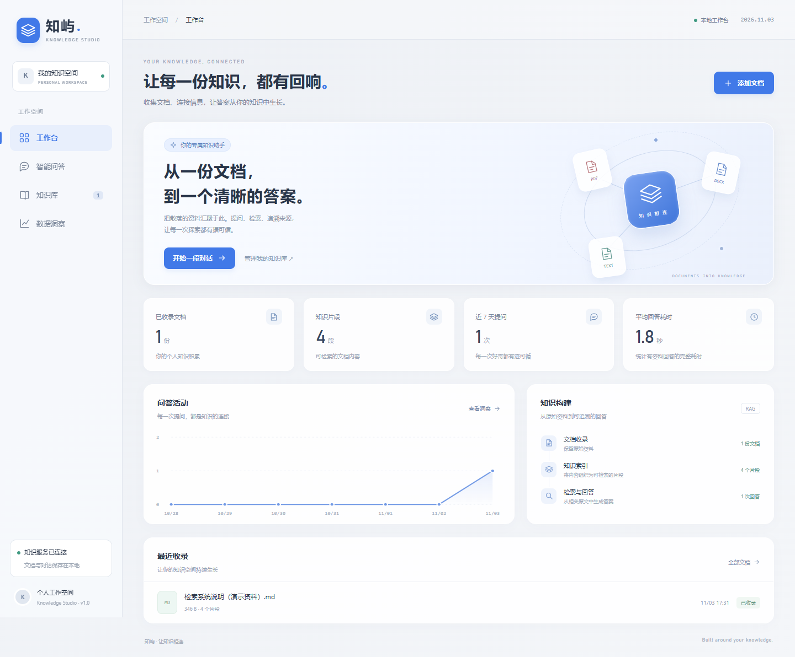

# 知屿 · Knowledge Studio

**面向个人资料的 RAG 知识工作台：让回答有出处，让原文可核对。**

[简体中文](README.md) · [English](README.en.md)

<p align="center">
  <a href="#highlights">项目亮点</a> ·
  <a href="#demo">实际界面</a> ·
  <a href="#architecture">架构设计</a> ·
  <a href="#quick-start">快速开始</a> ·
  <a href="#validation">验证与边界</a> ·
  <a href="#documentation">文档</a> ·
  <a href="#license">许可与来源</a>
</p>


> 截图来自项目的真实界面，使用隔离数据库、合成资料和预置演示回答；用于展示交互，不作为模型效果评测。README 提供中英文版本，当前应用界面为中文。

<a id="highlights"></a>
## 项目亮点

资料分散在 PDF、Word 和笔记里时，单纯生成一段答案很难让人判断是否可信。本项目将文档管理、检索、回答、引用和原文阅读放在同一个工作台中。

| 能力 | 代码中的实现 | 用户能看到什么 |
| --- | --- | --- |
| 双路检索 | Milvus 向量召回 + Neo4j 实体关系查询，按片段融合 | 语义相关资料和跨文档关系证据 |
| 可核对的回答 | 来源携带文档 ID、片段、页码；引用关联完整原件 | 点击引用打开全文、定位并高亮 |
| 后台建库 | SQLite 任务记录、单工作线程、失败补偿、重启恢复 | 上传后立即看到任务编号和处理阶段 |
| 多轮追问 | 使用近期已回答记录改写独立检索问题 | “它”“这个方案”等追问能结合上下文检索 |
| 流式交互 | SSE 推送状态、来源、图谱和文字增量 | 回答逐步呈现，完整结果持久化 |
| 本地运维 | 进程归属校验、健康检查、重复启动识别 | 一键启停网页及检查数据库依赖 |

本版本的扩展集中在工作台界面、文档生命周期、混合检索、引用阅读、持久化与本地运维。项目保留上游嵌入适配组件及其署名，详见 [NOTICE](../docs/third-party/NOTICE)。

<a id="demo"></a>
## 实际界面与演示路径



1. 上传 PDF、DOCX、TXT 或 Markdown，等待后台建库成功。
2. 提问并查看流式回答；继续追问，观察上下文改写后的检索结果。
3. 点击引用核对完整原文，或展开命中证据的局部关系图谱。
4. 在数据洞察页查看资料命中、问答耗时和历史记录。

架构与运行细节见 [架构说明](../docs/architecture.md)。

<a id="architecture"></a>
## 架构设计

```mermaid
flowchart TD
    UI[浏览器工作台] --> API[FastAPI / HTTP / SSE]
    API --> INGEST[后台建库任务]
    INGEST --> PARSE[文档解析与语义分块]
    PARSE --> EMBED[Jina 文档嵌入]
    EMBED --> MILVUS[(Milvus)]
    PARSE --> EXTRACT[有依据的关系抽取]
    EXTRACT --> NEO4J[(Neo4j)]
    API --> REWRITE[结合历史改写问题]
    REWRITE --> VECTOR[向量检索]
    REWRITE --> GRAPH[实体关系检索]
    VECTOR --> MILVUS
    GRAPH --> NEO4J
    VECTOR --> FUSE[片段去重与结果融合]
    GRAPH --> FUSE
    FUSE --> LLM[配置的生成模型]
    LLM --> ANSWER[流式回答与引用]
    ANSWER --> DB[(SQLite 会话与任务)]
    ANSWER --> UI
```



- **Milvus** 保存语义向量及片段，**Neo4j** 保存实体关系，**SQLite** 保存业务记录；三者职责分离。
- **Jina 嵌入模型**在 Python 后端加载；页面的“向量服务”状态检查的是 Milvus 连接。
- 文档清单只在两路索引写入成功后提交；跨库操作依靠补偿处理，未实现分布式事务。
- 模型通过 OpenAI 兼容协议接入，可配置服务地址和模型名。检索、问题改写及生成流程见 [混合检索说明](../docs/hybrid-rag.md)。

| 层次 | 技术 |
| --- | --- |
| 后端 | Python、FastAPI、Uvicorn、Pydantic |
| 检索与模型 | LangChain 适配、Sentence Transformers、Jina Embeddings v3 |
| 存储 | SQLite、Milvus、Neo4j |
| 前端 | Jinja2、原生 JavaScript/CSS、SSE |
| 原文与图谱 | PDF.js、Vis Network |
| 内容安全 | Marked + DOMPurify |
| 可选观测 | 独立的 Langfuse 启动入口 |

## 项目结构

```text
KB_project/
├── app/
│   ├── api/                 页面、文档与问答接口
│   ├── services/            建库、检索、关系抽取与生成
│   ├── repositories/        SQLite 数据访问
│   ├── web/                 模板、静态资源及第三方组件许可
│   ├── config.py            根目录定位与环境配置
│   ├── cli.py               网页进程启停
│   └── milvus_cli.py        已有 Milvus 容器启动与就绪检测
├── 启动_停止项目/           Windows CMD / PowerShell 入口
├── langfuse/                可选调用链观测
├── tests/                   隔离回归测试与固定评估样例
├── docs/                    架构、演示与发布说明
├── data/                    运行时 SQLite，仅保留空目录占位
└── upload_files/            用户原件，不上传 GitHub
```

<a id="quick-start"></a>
## 快速开始

### 1. 准备环境与配置

使用 Python 3.10，以及可用的 Milvus。启用图谱时需要 Docker Desktop；脚本通过 [compose.neo4j.yml](../compose.neo4j.yml) 管理 Neo4j。

```powershell
git clone https://github.com/Auroral666/KB_project.git
cd KB_project
py -3.10 -m venv .venv
.\.venv\Scripts\python.exe -m pip install -r requirements.txt
Copy-Item .env.example .env
```

编辑 `.env`，至少确认：

| 配置 | 用途 |
| --- | --- |
| `openai_api_key` / `openai_base_url` / `openai_llm_model_name` | 生成、问题改写和关系抽取的模型配置 |
| `text_embeddings_model_path` | Jina 模型标识或已准备好的本地模型目录 |
| `milvus_host` / `milvus_port` | 已有 Milvus 地址，默认 `localhost:19530` |
| `neo4j_password` | 为本机 Neo4j 设置自己的密码 |
| `neo4j_enabled` | `false` 可关闭图谱，仅使用向量检索 |

首次使用模型标识可能下载模型权重与模型代码。离线运行嵌入模型需要预先准备完整模型缓存；模型服务的使用条款独立于本项目许可。

### 2. 准备 Milvus

首次部署 Milvus 请按 [Milvus 官方安装文档](https://milvus.io/docs/v2.6.x/install_standalone-docker-compose.md) 操作。本项目启动器**复用已有容器，不会首次安装或重建 Milvus**。

本地默认容器名为 `milvus-etcd`、`milvus-minio`、`milvus-standalone`，可通过 `.env` 的 `milvus_etcd_container`、`milvus_minio_container`、`milvus_container` 调整。远程 Milvus 只检查连接，由远程主机负责启动。

### 3. 启动工作台

```powershell
$env:RAG_PYTHON = (Resolve-Path .\.venv\Scripts\python.exe).Path
.\启动_停止项目\启动项目.cmd
```

打开 **http://127.0.0.1:8010**。启动流程依次检查 Milvus、Neo4j、网页；模型预热在后台进行。

```powershell
.\启动_停止项目\停止项目.cmd
# 也可直接以前台模式启动，按 Ctrl+C 停止这个前台实例：
.\.venv\Scripts\python.exe -B -X utf8 -m app
```

停止入口只停止本项目网页进程，保留数据库容器。关闭启动窗口后后台服务仍继续运行。`RAG_PYTHON` 需要在每个新终端重新设置，或设为用户环境变量；旧机器的 Conda 路径仅是兼容默认值。

健康检查：`GET /health`；数据库、模型预热和图谱状态：`GET /api/status`。日志在 `temp/runtime/`。

<a id="validation"></a>
## 验证与实现边界

运行不调用外部生成模型的回归测试：

```powershell
.\.venv\Scripts\python.exe -m pip install -r tests/requirements.txt
.\.venv\Scripts\python.exe -B -X utf8 -m unittest discover -s tests -p "test_*.py" -v
```

前端 DOM 验证及独立的真实模型评估方法见 [tests/README.md](../tests/README.md)。真实评估会调用配置的模型服务，可能产生费用。

- 当前后台建库使用单进程队列，不能用多个 Uvicorn worker 共享同一任务队列。
- 支持 PDF、DOCX、TXT、MD，单文件最多 20 MB；扫描 PDF 需要先 OCR，DOCX 展示提取文本而非 Word 排版。
- 资料命中率不等于答案准确率；固定样例的评估结果不代表通用生产效果。
- 上传原件与业务记录保存在本机，但问题改写、关系抽取和生成需要把相关历史或文档片段发送给配置的模型服务。
- 当前以本机个人工作台为目标；公开源码不代表已经提供公网多租户部署能力。

<a id="documentation"></a>
## 进一步阅读

- [架构与数据维护](../docs/architecture.md)
- [混合检索与图谱](../docs/hybrid-rag.md)
- [图谱数据约定](../docs/graph-contract.md)
- [上传范围与排除清单](../docs/PUBLISHING.md)
- [English README](README.en.md)

<a id="license"></a>
## 许可与来源

保留上游 Knowledge_QA_RAG（CS_木成河）的适配组件、Apache License 2.0 和署名。详情见 [LICENSE](../docs/third-party/LICENSE)、[NOTICE](../docs/third-party/NOTICE)。前端第三方组件许可证位于 `app/web/static/vendor/`，模型权重及模型服务各自适用其许可或条款。
